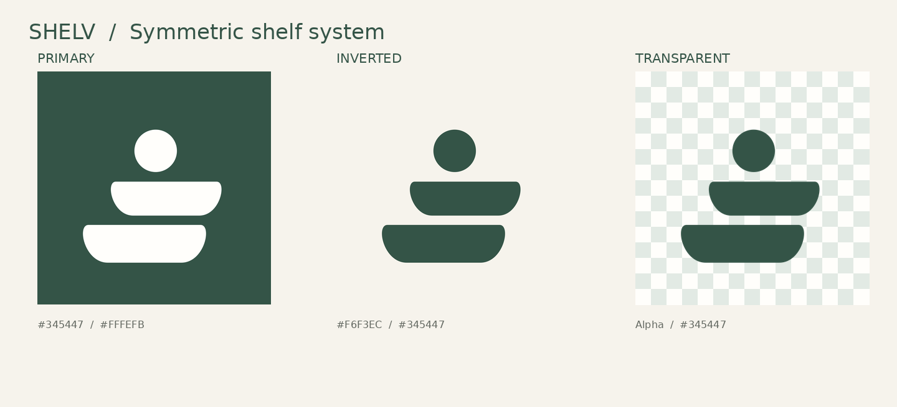

# Shelv branding and corrected artwork

Shelv is the current company/app brand, replacing Derive in customer-facing copy. Use **Shelv** in prose and **SHELV** where the existing design uses an uppercase wordmark. This pass changes presentation and documentation; product policy, release scope, paid-access status and infrastructure are unchanged.

## Source and provenance

The founder supplied `Downloads/shelv_corrected_geometry` (artwork dated 13 October 2026). The entire 20-file source set is preserved byte-for-byte under [`assets/brand/shelv/originals/`](../assets/brand/shelv/originals/). Downloads originals remain untouched. [`manifest.json`](../assets/brand/shelv/manifest.json) records exact SHA-256 checksums, byte sizes, the alpha-only crop, and runtime export recipes. The source [`README.txt`](../assets/brand/shelv/originals/README.txt) and [`geometry_spec.json`](../assets/brand/shelv/originals/geometry_spec.json) remain unmodified, including their historical repository references.

All five SVGs have a 700×700 viewBox, one circle and two shelf paths. The dot is at (354.5, 238.5), radius 63.7. The upper and lower shelves share reflected cubic curves; the lower is uniformly scaled by 1.1125827814569536 and staggered 65 units left. Keep all original path coordinates, dot placement and spacing. Original palette: green `#345447`, off-white `#FFFEFB`, ivory `#F6F3EC`. The supplied SVGs contain no scripts, event handlers, embedded raster, font dependencies or external references.

## Use the appropriate export

| Surface | Asset | Sizing rule |
| --- | --- | --- |
| GitHub/brand documentation | `originals/shelv_primary.svg`, `shelv_inverted.svg`, `shelv_transparent.svg` | Preserve the 700×700 canvas and aspect ratio. |
| iOS/Expo launcher | `assets/icon.png` | Exact supplied opaque primary 1024 PNG. The OS applies its corner mask. |
| Small in-app/auth/header mark | `assets/logo.png` | Exact alpha-bound crop of supplied transparent 2048 PNG; use existing square boxes with `contain`. Same bytes as `generated/shelv-mark-tight.png`. |
| Expo web favicon | `assets/favicon.png` | 64px resize of the primary PNG. |
| Android adaptive icon | `assets/android-icon-{foreground,background,monochrome}.png` | Transparent mark uniformly reduced to 768px and padded in a 1024px canvas for mask safety. White monochrome uses identical alpha. |
| Existing splash artwork slot | `assets/splash-icon.png` | Transparent 1024px export; this does not add a splash plugin or change startup behavior. |
| Founder console | `admin/brand/` | Byte-identical primary SVG and tight PNG copies, so serving `admin/` alone works. |
| Local Next web UI | `apps/web/public/brand/` | Byte-identical SVG/1024 PNG copies. This whole web project was already untracked; publish only with its own reviewed base. |

`*_rounded_preview.*` are reference previews only. `shelv_before_after.png` retains the prior asymmetric trace as historical evidence; do not use that trace as current branding. Resizing, uniform padding, raster alpha extraction and margin-only cropping are allowed; manually redrawing curves or stretching individual elements is not. Existing older art is superseded in place, with its prior bytes recoverable in Git history and the task baseline.

No separate approved wordmark artwork is present in the source set. The current interface typography spells Shelv/SHELV; no custom wordmark has been invented. Source licensing/ownership is founder-supplied provenance, not an independently established trademark or licensing clearance.

## Preserved technical identifiers — migrate last

The founder explicitly deferred technical renaming. Preserve these until an independently planned and approved migration, with compatibility, redirects, auth callbacks and stored-data recovery verified:

| Category | Existing identifiers/examples retained |
| --- | --- |
| Repository and local paths | `KanujVerma/derive`, canonical `projects/derive`, clone URL, branches, historical PRs/commits |
| Native/app identity | Expo slug/scheme `derive`, owner `derive-skincare`, `com.derive.skincare`, EAS project ID, native module/package names |
| Hosting/backend | Existing deployment/project/database names, Supabase project, function/RPC/schema names, storage buckets, all integration URLs |
| Public/support destinations | Existing `derive-beta-site.vercel.app` links and configured support/email destinations; no replacement domain has been supplied |
| Code/config contracts | `DeriveService`, `askDerive`, merchant/tier ID `derive`, `DERIVE_*`, `EXPO_PUBLIC_*`, `window.DERIVE_ADMIN_CONFIG`, package names |
| Persisted/verified evidence | `@derive/...` and `derive:...` storage keys, source/policy/release IDs, dictionary hashes/rights attributions, fixture identifiers |

Do not globally replace lowercase `derive`, rename source files/contracts, rewrite released evidence, edit old acceptance receipts, or claim a legal company-name change from this branding pass. Dated historical documentation remains evidence under the former name. Current documentation entrypoints identify Shelv and link here without rewriting prior release claims.

## Public-site copy and remaining server copy

The tracked `apple-site/` home, privacy, privacy-choices and support pages use Shelv and refer to the app's exact **Delete Shelv data** action. Existing URLs, support email and policy statements are preserved. Updating this source is separate from deploying that public site. Backend/API and authentication-email display wording retain pre-existing Derive references; that follow-up must preserve technical identifiers and pass its own backend/release checks.

## Shared-writer and publication boundaries

The scanner retake task owns the shared working copies of `src/components/check/CheckProductScreen.tsx`, `src/components/ui/CameraCapture.tsx` and `app/_layout.tsx`. Its writer has integrated the seven approved Shelv display substitutions locally. This publication independently replays only those same seven literals from pinned main, with no dirty scanner behavior or composition copied. This pass changes no scanner logic, root navigation, Auth, RLS, SQL, secrets, analytics payloads, hosted deployment or production settings.

The canonical local checkout has extensive unrelated edits and a branch 127 commits ahead of fetched `origin/main`. Publication uses a separate index/tree based directly on `fea1a214dd174deccffbdb08fb2aa48c1e8fd0e0`, preserving the shared checkout and excluding those commits. Main's account behavior is retained while its display wording changes. The original assets and canonical visible-brand changes are published together; the already-untracked local Next project and private handoff files are excluded. The shared scanner/root files contain only seven approved display substitutions from main. Exact-head CI and review are required before merge. The local integration's build/test receipts are not substituted for verification of the publication commit.

## 2026-10-17 public-site branding follow-up

The tracked `apple-site/` pages include byte-identical copies of the corrected tight mark, primary SVG and favicon from the canonical asset directory. The wordmark links home with a visible keyboard focus state; the image remains decorative and uses `contain`. Existing approved policy/product copy and support/privacy destinations remain unchanged. There is no script, analytics, form, customer capture or backend integration in this static-site change.

The existing public address `derive-beta-site.vercel.app` is retained during this pass so previously shared and app-configured links continue working. Vercel project `prj_zWLllmt0aN1NgUG1FnsJdSgjpyPN` remains the deployment target; its name is coupled to generated URLs and is not treated as an independent cosmetic field. A replacement public hostname needs a separate verified ownership/alias decision. PostHog project `623376` is named **Shelv**; a readback immediately after the name-only update confirmed every other setting unchanged, including replay being off at that point. Supabase projects `snojlbqovlawewwqbviz` and `qeocmbrgvxyiyxxoblpo` display **Shelv** and **Shelv Staging**, respectively, with their references and database hosts unchanged. The Supabase organization display name still needs its owner: the current administrator account cannot edit that field; its opaque slug is preserved. No database identity, bundle/EAS identity, OAuth callback, persisted key, domain DNS or secret is changed by this follow-up.
